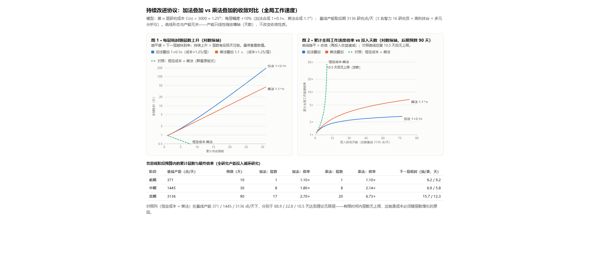

# 循环科技（Continuous Improvement）

一项采用「无限循环研究科技」设计的 RimWorld 1.7 Mod：在研究树的飞船科技右侧新增一组可无限循环研究的科技（工作速度、闪避、命中、瞄准、负重、移速、护甲、耐久、代谢九个方向）。每完成一次研究记为一层，层数随存档永久保留；每层效果按层数叠加，研究成本逐层指数递增以保证收益收敛，加法与乘法两种叠加公式可在 Mod 设置中随时切换。游戏文案（科技名称与描述、完成消息、属性面板明细、设置界面）内置简体中文与英文双语，跟随游戏语言设置自动切换。

## 循环科技总表

| 科技 | defName | 效果 | 每层幅度 | 挂点 |
|------|------|------|------|------|
| 全局工作速度循环科技 | `ContinuousImprovementProtocol` | 全体全局工作速度 | +10% | WorkSpeedGlobal 属性 |
| 近战闪避率循环科技 | `NimbleEvasionProtocol` | 近战闪避几率 | +5%（上限 ×2） | MeleeDodgeChance 属性 |
| 命中率循环科技 | `PrecisionProtocol` | 近战命中与射击精度 | +5%（上限 ×2） | MeleeHitChance + ShootingAccuracyPawn 属性 |
| 瞄准加速循环科技 | `RapidAimingProtocol` | 瞄准时间 | −5% | AimingDelayFactor 属性（反向） |
| 携带能力循环科技 | `LoadBearingProtocol` | 单次搬运容量 | +5% | CarryingCapacity 属性 |
| 移动速度循环科技 | `SwiftMovementProtocol` | 移动速度 | +5% | MoveSpeed 属性 |
| 高效代谢循环科技 | `EfficientMetabolismProtocol` | 食物消耗速率 | −5%（下限 ×0.25） | Need_Food 消耗率收口点（倍率显示于「食物消耗」分解与信息卡食物类目） |
| 护甲循环科技 | `ArmorRatingProtocol` | 锐器/钝器/热能护甲值 | +5%（上限 ×2） | ArmorRating_Sharp/Blunt/Heat 属性 |
| 耐久度上限循环科技 | `DurabilityProtocol` | 建筑与随身装备耐久上限 | +10% | MaxHitPoints 属性（实时取值，已建成建筑即时生效） |

九项科技共用一套机制：每项独立计层（按 defName 存档持久化）、独立成本曲线（3000 × 1.25^N）、完成自动续研、名称实时携带层数；同一设置中的加法/乘法公式对所有科技统一生效。由此形成循环科技的核心玩法——研究产能有限时「下一个点谁」的持续取舍：工作速度、负重与移速是产出向，闪避、命中、瞄准是战斗向，护甲与耐久是防御向，代谢是后勤向。

## 科技蓝图（可选）

参考原版 Royalty 的蓝图机制：默认情况下，每项循环科技需要 1 张科技蓝图才能开始研究，蓝图由帝国阵营的商人（基地、旅队、轨道商船）出售，每张定价 1500 银。蓝图是一次性解锁——应用后该科技的全部后续循环层都不再需要蓝图。Mod 设置中提供「需要科技蓝图」开关（全局配置，默认开启），关闭后蓝图判定直接通过；该机制依赖 Royalty DLC，故本 Mod 声明了对 Royalty 的依赖。

## 机制

研究树中的「全局工作速度循环科技」（defName `ContinuousImprovementProtocol`）没有前置科技、不要求特定研究台，第 0 层成本 3000 研究点。完成一层的瞬间会发生四件事：层数加一并随存档持久化；全局工作速度倍率按新层数提升；研究进度清零、成本乘以 1.25，该科技重新变为可研究；当前研究项目自动重设为该科技，殖民者无需重新指派即可继续下一层。层数存储与游戏本体存档绑定，删除本 Mod 不留任何残留。科技名称会实时携带当前层数（如「全局工作速度循环科技（3 层）」），研究树、完成消息与设置页共用这一标识。

全局工作速度（WorkSpeedGlobal）是全部主要产能工作的公共乘数——研究、制作（裁缝/艺术/锻造/切石）、烹饪、熔炼、酿造、屠宰、建造、采矿、深钻、种植、驯兽收获、黑客。因此循环研究的收益会自动传导到殖民地的所有产出，同时因为研究速度也以它为因子，协议存在自举效应：层数越多，下一层研究越快，这正是成本必须逐层递增的原因。

本协议对原生体验做了两处适配：完成时不再弹出强制暂停的原版研究完成对话框（逐层弹窗会打断自动化游玩），改为一条右下角正面消息；开发者工具「完成全部研究」也做了校正，不会把协议卡在已完成状态。

## 等级与加成

两种叠加公式的每层幅度相同（+10%），区别在合成方式：加法为 `1 + 0.1N`（收益线性），乘法为 `1.1^N`（收益指数）。

| 层数 N | 加法 1+0.1N | 乘法 1.1^N | 第 N+1 层成本 |
|------|------|------|------|
| 1 | ×1.1 | ×1.10 | 3,750 |
| 2 | ×1.2 | ×1.21 | 4,688 |
| 3 | ×1.3 | ×1.33 | 5,859 |
| 5 | ×1.5 | ×1.61 | 9,155 |
| 8 | ×1.8 | ×2.14 | 17,881 |
| 10 | ×2.0 | ×2.59 | 27,940 |
| 12 | ×2.2 | ×3.14 | 43,656 |
| 15 | ×2.5 | ×4.18 | 85,265 |
| 20 | ×3.0 | ×6.73 | 260,209 |
| 25 | ×3.5 | ×10.83 | 794,093 |
| 30 | ×4.0 | ×17.45 | 2,423,381 |

## 迭代速度

阶段产能按典型殖民地建模（智力技能系数 0.08 + 0.115/级，每人每日 495 点基础产出）：前期 1 名智力 8 研究员配简易研究台约 371 点/天，中期 2 名智力 12 配高科技研究台约 1445 点/天，后期 3 名智力 16 配多元分析仪约 3136 点/天。

第一次循环耗时：前期约 8.1 天、中期约 2.1 天、后期约 1.0 天。每层耗时随成本递增，下表为逐层耗时（天）：

| 层数 n | 前期 加法 | 前期 乘法 | 中期 加法 | 中期 乘法 | 后期 加法 | 后期 乘法 |
|------|------|------|------|------|------|------|
| 0 | 8.08 | 8.08 | 2.08 | 2.08 | 0.96 | 0.96 |
| 1 | 9.18 | 9.18 | 2.36 | 2.36 | 1.09 | 1.09 |
| 2 | 10.52 | 10.43 | 2.70 | 2.68 | 1.25 | 1.24 |
| 3 | 12.14 | 11.86 | 3.12 | 3.05 | 1.44 | 1.40 |
| 5 | 16.44 | 15.31 | 4.22 | 3.93 | 1.95 | 1.81 |
| 8 | 26.76 | 22.47 | 6.87 | 5.77 | 3.17 | 2.66 |
| 10 | 37.63 | 29.02 | 9.67 | 7.45 | 4.45 | 3.43 |
| 12 | 53.45 | 37.47 | 13.73 | 9.62 | 6.33 | 4.44 |
| 15 | 91.87 | 54.98 | 23.60 | 14.12 | 10.87 | 6.51 |
| 20 | 233.63 | 104.18 | 60.01 | 26.76 | 27.66 | 12.33 |

累计耗时（从零层研到第 N 层，天）：

| 完成层数 N | 前期 加法 | 前期 乘法 | 中期 加法 | 中期 乘法 | 后期 加法 | 后期 乘法 |
|------|------|------|------|------|------|------|
| 1 | 8.1 | 8.1 | 2.1 | 2.1 | 1.0 | 1.0 |
| 3 | 27.8 | 27.7 | 7.1 | 7.1 | 3.3 | 3.3 |
| 5 | 54.0 | 53.0 | 13.9 | 13.6 | 6.4 | 6.3 |
| 8 | 112.4 | 105.5 | 28.9 | 27.1 | 13.3 | 12.5 |
| 10 | 170.8 | 153.5 | 43.9 | 39.4 | 20.2 | 18.2 |
| 12 | 253.3 | 215.5 | 65.1 | 55.4 | 30.0 | 25.5 |
| 15 | 447.2 | 343.9 | 114.9 | 88.3 | 52.9 | 40.7 |



左图是每层耗时随层数的变化（对数纵轴）：加法模式每层耗时渐近增长 25%，乘法模式稳定增长 13.6%（1.25/1.1），两者都是几何增长、永不归零，所以层数有实际天花板。右图是累计工作速度倍率随投入天数的爬升曲线：后期 90 天全产能预算下，加法达到 17 层（×2.70），乘法达到 20 层（×6.73）——乘法收益约为加法的 2.5 倍，但仍在成本增长约束下收敛。可交互版本（悬停查看每层数值、明暗主题自适应）见 `docs/loop_research_convergence.html`。

收敛性的反例是「恒定成本 + 乘法」的方案：三个阶段产能下分别只需 88.9 / 22.8 / 10.5 天就达到理论无限层（总耗时 = 3000/产能 × 11，为有限值），层数无上限即数值失控，这是本 Mod 采用成本递增的原因。上述全部数字可用 `python docs/convergence_sim.py` 复算，脚本内可调整技能等级、研究员数量与成本参数。

## 设置

游戏内「选项 → Mod 设置 → 循环科技（Continuous Improvement）」提供叠加方式切换：加法（+10%/层，默认）或乘法（×1.1/层）。设置保存在全局配置（不随存档），切换即时生效——已有层数按新公式重算，下一次层数完成与下一次属性求值即用新公式，无需重启游戏。设置页同时显示当前层数、全局工作速度倍率与下一层成本，并以对照表列出各层数两种公式的加成与成本（当前状态行高亮）。

## 安装与构建

已通过目录联接部署：`F:\SteamLibrary\steamapps\common\RimWorld\Mods\ContinuousImprovement` → `publish\ContinuousImprovement`。手动安装时把 `publish\ContinuousImprovement` 整个目录复制进游戏 `Mods\` 即可，需要 Harmony（创意工坊 1.7 版）。构建与部署：

```bash
dotnet build
python scripts/deploy_mod.py
```

部署脚本把 DLL、About、Defs 与 README 组装到 `publish\ContinuousImprovement\`（游戏 Mods 目录的联接指向此处）。游戏运行中部署会自动换新被锁定的 DLL（旧文件改名保留、24 小时后清理），重启游戏后加载新版本。

## 技术实现要点

加成通过自定义 `StatPart` 在启动时注入 `StatDefOf.WorkSpeedGlobal.parts` 实现——属性在 `StatWorker.FinalizeValue` 统一应用该列表，因此加成自动覆盖全部引用 WorkSpeedGlobal 的工作速度，并在殖民者属性面板显示明细行，无需逐项修改任何工作类型。层数累计较验挂在 `ResearchManager.FinishProject`：所有常规完成路径（殖民者研究、任务奖励 `AddProgress`、异常知识）都收口于此，任何路径完成一层都不会漏计；同一补丁把本协议的完成弹窗参数关闭。层数经 `GameComponent_CyclicResearch` 随存档持久化，读档后按层数重算 Def 的 baseCost（Def 是跨存档全局对象，切换存档必须重算）。倍率公式实时读取 Mod 设置，与存档无关。
